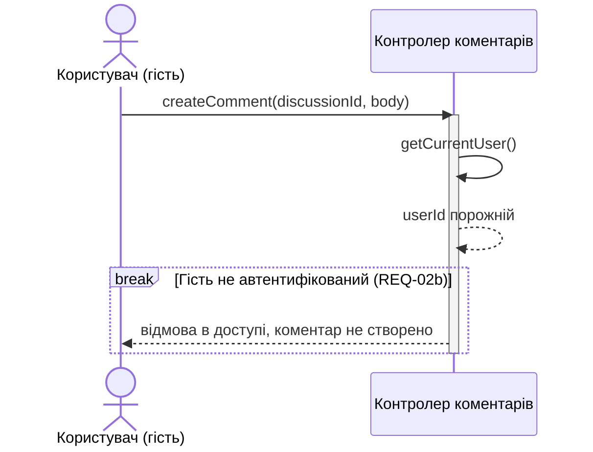
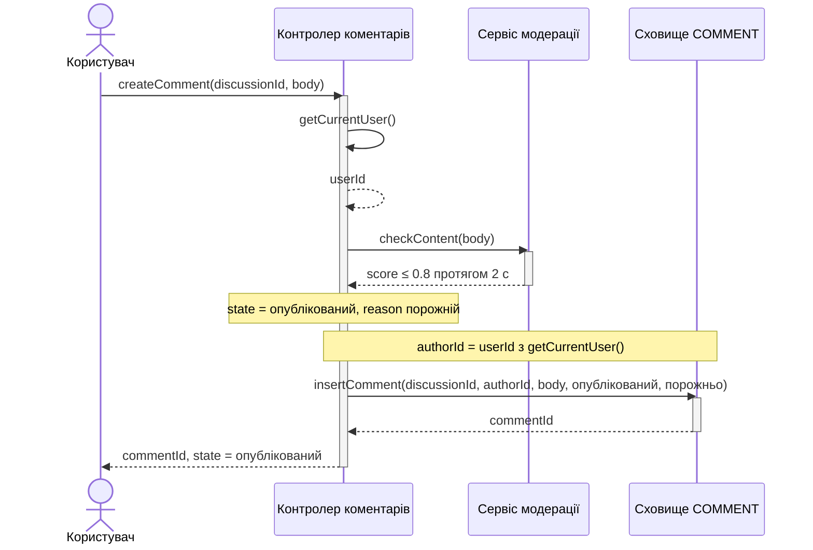
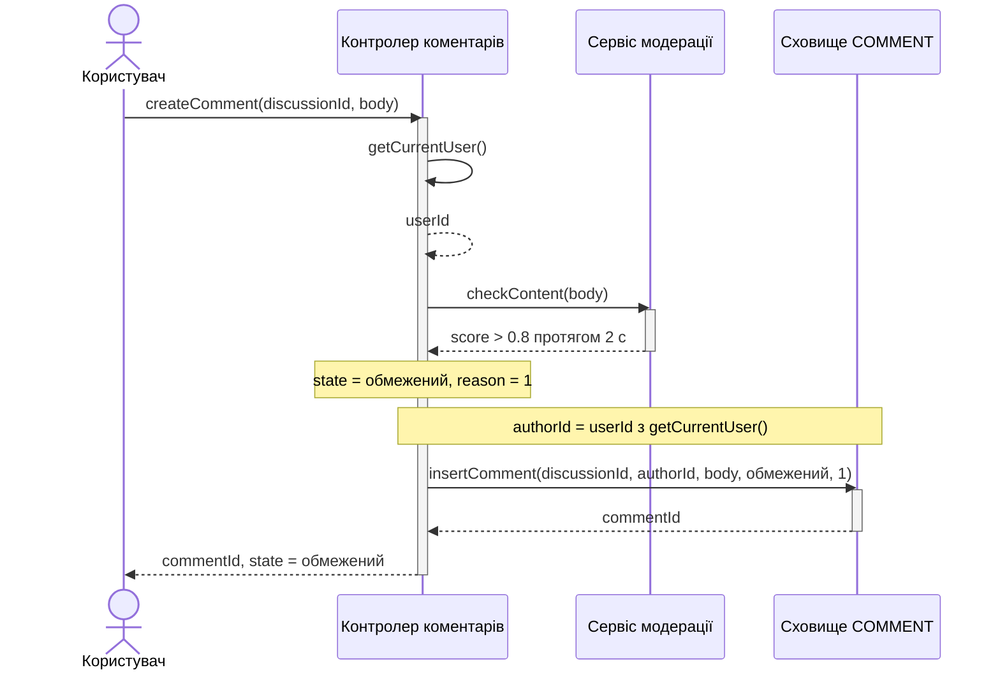
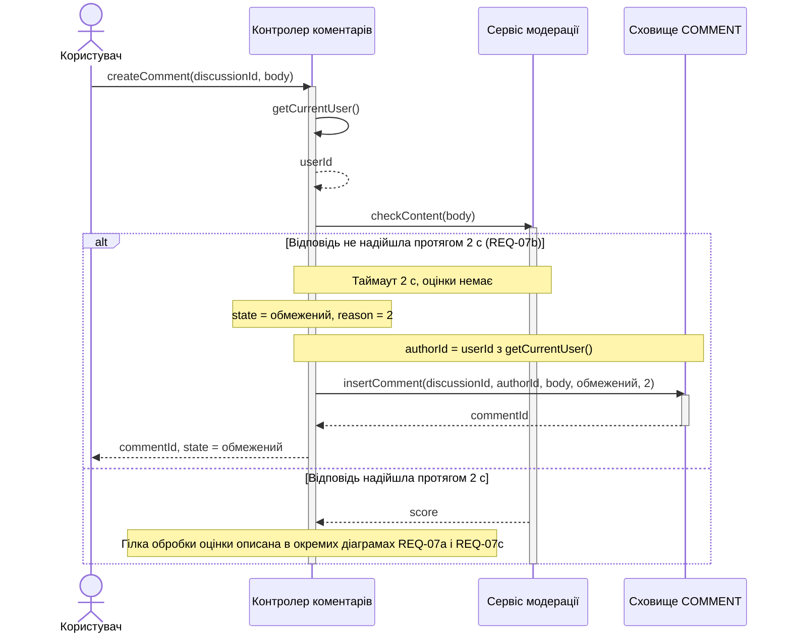

# Взаємодія UC_Comment: створення коментаря

Кожна діаграма показує окремий сценарій із `lab3/spec.md`. Активаційні смуги показані лише для учасників, які виконують дії у відповідному сценарії.

## Гість отримує відмову (REQ-02b)

## Коментар опубліковано (REQ-07c)

## Коментар обмежено за оцінкою (REQ-07a)

## Коментар обмежено через таймаут (REQ-07b)

